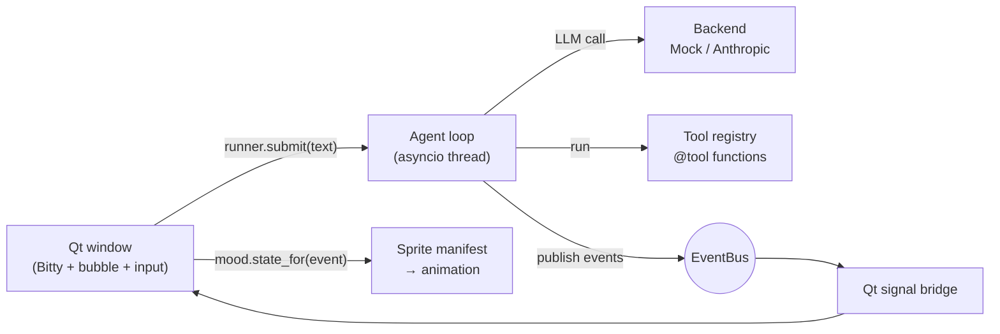

<h1 align="center">🤖 Bitty</h1>

<p align="center">
  <b>A bitty pixel buddy that lives on your desktop and runs an AI agent.</b><br>
  Bitty hops when a task finishes, squints while working, and gets confused when a tool breaks.
</p>


Most agents are a text box. Bitty is an agent you can *see working*: the creature reacts to
what the agent is actually doing (thinking, running a tool, asking permission, failing) instead of
just showing a chat log.

- 🪟 Frameless, transparent, always-on-top window: click to chat, drag to move, right-click for a menu
- 🔧 Tool use with permission prompts right in the speech bubble
- 🎨 Data-driven sprites: swap the art by editing a JSON file, no code changes
- 🔌 Modular: agent, tools, channels and creature only talk through a small event bus
- 📴 Works offline with a mock backend, or with Claude via the Anthropic API

## Quick start

```bash
pip install -r requirements.txt
python main.py --mock            # offline demo, no API key needed
```

Try typing: `what time is it` · `add a note: buy milk` · `find resume`

To use a real model:

```bash
export ANTHROPIC_API_KEY=sk-ant-...
python main.py
```

| Option | What it does |
|---|---|
| `--mock` | Force the offline backend |
| `--scale 6` | Make Bitty bigger (default 4) |
| `--sprites my.json` | Use your own sprite sheet |
| `BITTY_MODEL` | Override the Claude model |
| `BITTY_NOTES` | Where `add_note` writes (default `~/.bitty/notes.txt`) |

## Meet Bitty

Each row of the sprite sheet above is a state. Bitty picks one from what the agent is doing:

| State | Triggered by |
|---|---|
| `alert` | you send a message |
| `thinking` | waiting on the LLM |
| `working` | a tool is running (tools can name their own, e.g. `working:search`) |
| `curious` | asking you for permission |
| `happy` | task finished |
| `confused` | a tool failed or an error occurred |
| `idle` | nothing going on |
| `sleeping` | 45 seconds of nothing |

**Why events instead of asking the LLM how it feels?** Asking a model for its mood every turn is
slow, costs tokens and is inconsistent. Deriving state from lifecycle events (`mood.py`) is
instant, free and always accurate. The model can still add personality: publish a `MOOD` event
with `state="happy"` for special moments.

## How it works

The agent (brain), the channels (ways to talk to it) and the creature (how it feels) only
communicate through typed events.



### Life of one message: `add a note: buy milk`

| # | Event | Bitty does |
|---|---|---|
| 1 | `user_message` | perks up (`alert`) |
| 2 | `thinking` | thinking loop while the LLM runs |
| 3 | `assistant_text` "On it!" | speech bubble appears |
| 4 | `permission_request` (`add_note` is tier `ask`) | looks `curious`, bubble shows Allow / Deny |
| 5 | `tool_started` | `working` (falls back from `working:write`) |
| 6 | `tool_finished` | back to `thinking` (or `confused` on failure) |
| 7 | `assistant_text` "Done!..." | bubble |
| 8 | `done` | `happy` hop, then back to `idle` |


## Project layout

```
main.py                    
bitty/
  events.py                event names + EventBus 
  agent.py                 agent loop, tool execution, permission flow, AgentRunner
  backends.py              MockBackend (offline) and AnthropicBackend
  tools.py                 @tool decorator + ToolRegistry (schema from type hints)
  builtin_tools.py         current_time, search_files, add_note
  mood.py                  event -> animation state (pure functions, unit-tested)
  ui/sprites.py            sprite sheet + manifest loader
  ui/window.py             the creature window, bubble, input, drag handling
assets/
  make_placeholder.py      generates the placeholder sprite sheet, zero dependencies
  sprites/blob.{png,json}  sprite sheet + manifest
tests/test_core.py         tests for the non-UI core
```
